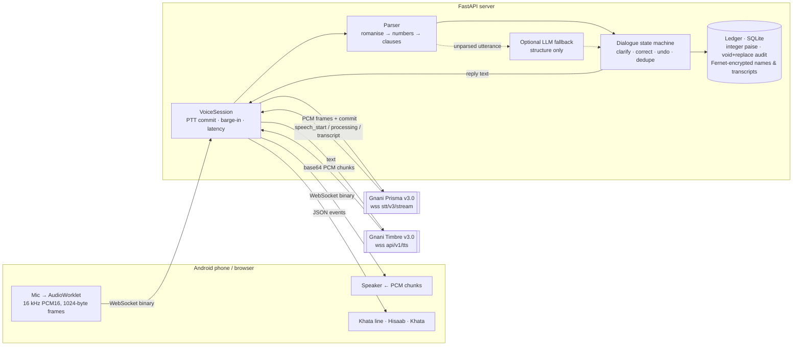

# Namma Chotu: Voice Khata for kirana stores

**Gnani Voice Hackathon · PS2.** A shopkeeper talks across the counter, mid-sale: *"Ramesh ka 340 udhaar, kal 200 diya tha"* or *"ರಮೇಶ್ ಮುನ್ನೂರ ನಲವತ್ತು ಉದ್ರಿ, ನಿನ್ನೆ ಇನ್ನೂರು ಕೊಟ್ಟರು"*. The ledger updates correctly without anyone touching the screen, and the agent says back who owes what.

- **Speech:** Gnani **Prisma v3.0** (streaming STT, WebSocket) and Gnani **Timbre v3.0** (streaming TTS, WebSocket)
- **Orchestration:** custom asyncio orchestrator (no hosted agent platform in the loop)
- **Brain:** an LLM (Groq `openai/gpt-oss-20b` by default, or xAI Grok; any OpenAI-compatible API) turns free speech plus the conversation so far into structured commands: credit, payment, loan, correction, undo, new customer, rename, questions. A deterministic ledger engine does all the money maths. No LLM ever touches a balance, and an amount the LLM "heard" that our own number parser didn't is confirmed out loud before it's written. If the LLM is slow or down, the rule parser takes the turn.
- **Money logic:** every entry is "you gave" (customer owes you more) or "you got" (owes you less / you owe them). Each person has one balance shown as *Lena hai ₹X* or *Dena hai ₹X*. The bare words "credit"/"debit" are never guessed: Chotu asks. A balance that would flip sides is always confirmed first.
- **Time:** every entry is stamped with its time; "shaam 5 baje" sets it explicitly. Summaries work for any day ("kal ka hisaab", "12 tareekh ka hisaab"), and Hisaab shows today and yesterday.
- **Reminders:** "mujhe shaam 7 baje yaad dilana …" (spoken + pop-up while the app is open), a daily closing summary at a set time, and polite WhatsApp reminders to customers.
- **"Hey Chotu":** on-device wake word (Picovoice Porcupine), one command per wake with a loudness gate against background voices, then an 8 s follow-up window.
- **Storage:** SQLite on a laptop, Postgres when hosted (data survives restarts). Customer names, phones and transcripts are encrypted at rest.
- **Languages:** Hindi, Kannada and English, mixed freely in one sentence ("Ramesh ka munnooru nalavattu udhaar"). Replies come in the shopkeeper's language and script. Other Indic languages go to the optional LLM fallback.
- **Device:** any browser, including low-end Android Chrome. Plain HTML/JS with no build step; push-to-talk or hands-free.

## For judges: try it in 2 minutes

- **Live app:** https://namma-chotu.onrender.com/ · Open it in **Chrome** (phone or laptop) and allow the microphone. The first open can take about 50 s while the free server wakes up.
- Pick a language, then either **hold the mic**, say **"Hey Chotu"** and wait for the beep, or tap **बात करो** for a hands-free voice conversation.
- Try saying:
  - "Suresh ne 500 ki shopping kari"
  - "इसको 200 और देना है"
  - "Ramesh 300 credit" (Chotu asks: दिया या मिला?)
  - "Nahi, 250" (corrects the last entry)
  - "सबका हिसाब बताओ"
  - "7:45 बजे याद दिलाना चाय"
  - "आज का हिसाब"
- The customers are synthetic demo data. The **Hisaab** tab shows today, yesterday, reminders and totals; **Khata** has every customer.
- Team Sigmoid: Monisha B K, Aniket Agarwal

## Architecture



**Turn latency path (push-to-talk).** On release the server sends `{"type":"commit"}` to Prisma, so end of speech is known instantly instead of waiting for VAD silence. Prisma returns the transcript, NLU and the ledger take under 5 ms, and Timbre streams back the first chunk. The UI shows the measured *end of speech → first audio* time in the header.

## Gnani API Platform services used

| Service | Model | How we use it |
|---|---|---|
| Realtime STT `wss://api.vachana.ai/stt/v3/stream` | `prisma-v3.0` | Headers `language_code=hi-IN,kn-IN,en-IN`, `format=transcribe` (digits, Hindi in Devanagari, English in Latin), `keyterms` = customer names, VAD tuned per mode, `commit` on button release, `update_settings` bias when a customer is added, `detected_language_code` to answer in the shopkeeper's language |
| Realtime TTS `wss://api.vachana.ai/api/v1/tts` | `timbre-v3.0` | Voice `Shivani`, `hi-IN` / `kn-IN` / `en-IN` (names transliterated to Kannada script so they're pronounced natively), raw PCM 16 kHz, warm socket per session. Barge-in closes the socket mid-stream (the API has no cancel message) and it reconnects for the next reply. Amounts are sent as words ("तीन सौ चालीस रुपये"). |

No telephony, no phone numbers, no voice cloning.

## Setup (5 minutes)

```bash
git clone <repo> && cd namma-chotu
python -m venv .venv && source .venv/bin/activate        # Windows: .venv\Scripts\activate
pip install -r requirements.txt
cp .env.example .env                                      # put GNANI_API_KEY in .env
```

**1. Prove the Gnani connection first** (about 2 minutes, a few credits):

```bash
python scripts/smoke_tts.py      # Timbre v3.0 → writes smoke_tts.wav, prints first-chunk latency
python scripts/smoke_stt.py      # streams that wav into Prisma v3.0, sends commit, prints the transcript
```

**2. Run the app:**

```bash
uvicorn app.main:app --host 0.0.0.0 --port 8000
```

Open http://localhost:8000 on the laptop.

**Hosted link (Render, free):** dashboard.render.com, then New, then Blueprint, then pick this repo (it reads `render.yaml`). Paste `GNANI_API_KEY` and `LLM_API_KEY` when asked. The blueprint also creates a free Postgres database, so the khata survives restarts. You get an `https://….onrender.com` link that works on any phone (HTTPS, so the mic works). On the free tier the first visit after 15 idle minutes takes about 50 s to wake.  On a phone the mic needs **HTTPS**, so tunnel it:

```bash
cloudflared tunnel --url http://localhost:8000     # or: ngrok http 8000
```

Without a key (`VOICE_MODE=mock`) the app runs in **mock mode**: typed text only, nothing spoken, and the header says so. It never pretends to be Gnani.

## Using it

- **Pick the shopkeeper's language** (हिंदी / ಕನ್ನಡ / English) on the start screen, or switch any time from the header. Chotu understands all three, mixed, whatever is picked. Replies and every screen label follow the chosen language. *Auto* replies in whichever language was spoken.

- **Hold the green button and talk.** Release when done. Space bar works too on a laptop.
- **Hands-free:** tap "Hold to talk" to switch. Start commands with **"Chotu, …"**, so customers chatting at the counter are ignored. Talking over the agent stops it (barge-in).
- Things to say:
  - `Ramesh ka 340 udhaar, kal 200 diya tha` (two entries; asks *"कौन से रमेश?"* because two Rameshes exist)
  - `nahi, 430` · `340 nahi 430 tha` · `Ramesh nahi Suresh` · `kal nahi, parso` · `udhaar nahi, jama tha`
  - `last entry cancel karo` · `Suresh wali entry hatao`
  - `Ramesh Kumar ka total?` · `Aaj kitna udhaar gaya?` · `Is hafte kitne payments aaye?` · `Sabse zyada udhaar kispe hai?` · `Kitna paisa market mein pending hai?` · `Ramesh ka last payment kab aaya tha?`
  - `Gupta ji ko reminder bhejo` (only for customers who opted in; the shopkeeper taps to send it)
  - Kannada: `Ramesh Kumar munnooru nalavattu udri` · `Suresh ninne innooru kottru` · `illa, 430` · `Ramesh Kumar ottu eshtu baaki?` · `ivattu eshtu udri hoytu?`
  - Guardrails: `Ramesh ko 500 pe byaaj lagao` is refused (no lending or interest) · `...warna police` is refused (no pressure language)

## What makes the numbers trustworthy

- **Every amount form in the PS:** `340`, `₹1,250`, `teen sau chaalis`, `three-forty`, `barah sau pachaas`, `do hazaar paanch sau`, all 99 Hindi number words in Devanagari, plus `dedh sau` (150), `dhai hazaar` (2500), `sadhe teen sau` (350), `sawa`/`paune`.
- **Direction from grammar, not guesses:** `Ramesh ne 200 diye` is a payment and `Ramesh ko 200 ka saaman diya` is credit. `Gupta ji se 300 liye` is a payment.
- **Never writes on:** a future promise (`kal 200 dega`), a negation (`paise nahi diye`), an unknown name (asks to create the account), an ambiguous name (asks which one), an overpayment (asks before recording an advance), or a huge or unclear amount (asks).
- **Commit and read back:** an entry is written immediately and spoken back. A correction voids the old row and writes a replacement, so the audit trail keeps both.
- Every balance and dashboard figure is a SQL aggregate over integer paise.

## Responsible AI

| Baseline | Where |
|---|---|
| AI disclosure in the first turn, in the user's language | Greeting says "मैं … एक AI सहायक हूँ". If the shopkeeper switches language, the first reply in the new language says it again (`dialogue.py`). |
| Synthetic data only | `app/seed.py` uses fictional customers and `98765 000xx` numbers |
| Encrypted at rest | Names, phones, notes, transcripts, reminder texts and audit details are Fernet-encrypted in SQLite (`app/db.py`) |
| Transcripts deleted after judging | `python scripts/purge_transcripts.py` or `POST /api/admin/purge-transcripts` |
| No lending, no pressure, opt-in reminders | Interest and loan requests are refused by voice, and threat-like wording is refused. No loan features. Reminder text is fixed and polite, refused for non-opted-in customers, and never auto-sent: the shopkeeper taps WhatsApp. |
| Secrets | `.env` is gitignored; the key never reaches the browser |
| No voice cloning | Stock Timbre v3.0 voice |

## Tests

```bash
pytest -q          # 137 tests: numbers (Hindi/Kannada/English), judge scenarios, Kannada, guardrails, end-to-end voice loop
```

`tests/test_voice_pipeline.py` runs the full loop (browser WebSocket → orchestrator → STT adapter → ledger → TTS adapter → browser) against `tests/fake_gnani.py`, a local server built from Gnani's documented wire format. It covers frame sizes, commit, base64 chunks with WAV headers and barge-in. **It is not Gnani.** Real-service verification is `scripts/smoke_*.py` plus the manual checklist in `docs/VOICE_TEST_CHECKLIST.md`. Kannada and Hindi wording review: `docs/LANGUAGE_REVIEW.md`.

## Database schema

`customers(id, name_enc, name_hi_enc, phone_enc, reminder_opt_in, created_at, active)`
`transactions(id, customer_id, kind CREDIT|PAYMENT, amount_paise >0, txn_date IST, created_at, status active|voided, void_reason, replaced_by, replaces, source, session_id, utterance_id, confidence, note_enc)`
`audit_log(id, ts, action, txn_id, customer_id, session_id, details_enc)` · `transcripts(…, text_enc, lang, latency_ms)` · `reminders(…, message_enc, status)`

## Project layout

```
app/
  main.py            FastAPI: static UI, REST, /ws
  voice_session.py   orchestrator (PTT commit, hands-free, barge-in, latency)
  gnani/stt.py       Prisma v3.0 WebSocket adapter
  gnani/tts.py       Timbre v3.0 WebSocket adapter
  nlu/               romanise · numbers · names · lexicon · parser
  dialogue.py        state machine (clarify / correct / undo / dedupe / disclosure)
  ledger.py db.py    money engine + encrypted SQLite
  responses.py numwords.py   Hindi/English replies, amounts as words
  llm.py             optional structure-only fallback
web/                 index.html · app.js · pcm-worklet.js · styles.css
scripts/             smoke_tts.py · smoke_stt.py · chat.py (text REPL) · purge_transcripts.py
tests/
```
